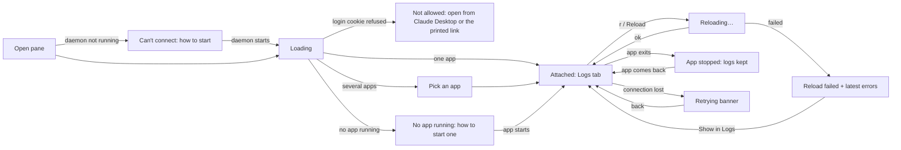

# M2 dashboard — UI spec

Date: 2026-10-14 — Design note: [design/m2-dashboard.md](../design/m2-dashboard.md) — Status: draft, waiting for PM

## User and task

- User: a Flutter developer working in Claude Desktop's Code tab, with the app started from their IDE or terminal.
- Task: see which app FlutterDeck is attached to, reload or restart it, read its logs (Dart and Android native) and see what happened while they were away (reloads, crashes, Claude finished or waiting), without leaving Claude Desktop.
- Success: reload from the dashboard in one click or key press; a new log line visible in under 250 ms; at 420 px wide every control is usable with no sideways scrolling; a first-time user finds the reload button and the Logs tab without help (QA walkthrough).

## Flow



## Layout (420 px)

```
┌──────────────────────────────────────────┐
│ [▾ flutterdeck_sample · Pixel 9 · IDE ]  │  app picker (full width)
│ [⟳ Reload r] [↻ Restart R]   ● 182 ms    │  actions + last result
├──────────────────────────────────────────┤
│  Logs   Activity                          │  tabs
├──────────────────────────────────────────┤
│ [Search logs…        ] [Level ▾] [⋯]     │  filters; ⋯ = source, tag, since reload, pause, clear
│ 12:01:02 I app   flutter: Tap 3          │
│ 12:01:03 E native FlutterDeckSample: …   │  virtualised list
│ …                                        │
├──────────────────────────────────────────┤
│ Connected · v0.1.0                        │  footer status
└──────────────────────────────────────────┘
```

## States matrix

| Screen / component       | Default                                                                                                                                                   | Hover                         | Focus                                                        | Disabled                                                                    | Loading                                                 | Empty                                                                                                       | Error                                                                                                                       | Success                                                                                                                               | Long content                                                                                       | Offline                                                                                 | Permission denied                                                                                                    |
| ------------------------ | --------------------------------------------------------------------------------------------------------------------------------------------------------- | ----------------------------- | ------------------------------------------------------------ | --------------------------------------------------------------------------- | ------------------------------------------------------- | ----------------------------------------------------------------------------------------------------------- | --------------------------------------------------------------------------------------------------------------------------- | ------------------------------------------------------------------------------------------------------------------------------------- | -------------------------------------------------------------------------------------------------- | --------------------------------------------------------------------------------------- | -------------------------------------------------------------------------------------------------------------------- |
| App picker               | Attached app name, device, "started from IDE/terminal"                                                                                                    | Background tint               | 2 px focus ring, list opens on Enter/Space                   | While attach runs                                                           | "Finding apps…" with spinner (static if reduced motion) | "No app running" + hint "Start your app from your IDE or `flutter run`; FlutterDeck finds it automatically" | "Couldn't attach: <reason>. Try again" button                                                                               | Picker shows the new app; Activity gets "Attached to …"                                                                               | Name truncated with ellipsis; full name in the list and `title`                                    | Disabled, shows last app greyed                                                         | n/a — no per-user permissions on localhost                                                                           |
| Reload / Restart buttons | Icon + label + key hint (r / R)                                                                                                                           | Tint                          | Focus ring                                                   | No app attached, or a reload is running (`aria-disabled`, tooltip says why) | Label "Reloading…", spinner, still focusable            | n/a — hidden only if the app reports `unsupported`, then text "Reload not available for this app"           | Red result chip "Reload failed" + first 3 error log lines + "Show in Logs"                                                  | Green chip "Reloaded in 182 ms" for 10 s, then neutral "Last reload 12:01"                                                            | n/a                                                                                                | Disabled with "Not connected"                                                           | n/a                                                                                                                  |
| Result chip              | Neutral "No reload yet"                                                                                                                                   | n/a                           | Focusable when it has details                                | n/a                                                                         | n/a                                                     | n/a                                                                                                         | Red, expands to error lines (max 3, each one line, ellipsis)                                                                | Green                                                                                                                                 | Error text ellipsis, full text in Logs                                                             | Hidden                                                                                  | n/a                                                                                                                  |
| Tabs (Logs, Activity)    | Logs selected                                                                                                                                             | Underline tint                | Focus ring; arrow keys move between tabs (ARIA tabs pattern) | n/a                                                                         | n/a                                                     | n/a                                                                                                         | n/a                                                                                                                         | n/a                                                                                                                                   | n/a                                                                                                | Still switchable                                                                        | n/a                                                                                                                  |
| Logs list                | Newest at bottom, auto-follow; time, level letter, source, tag, message                                                                                   | Row tint; copy button appears | Row focus ring; Enter expands a multi-line entry             | n/a                                                                         | Skeleton rows on first load                             | "No logs yet. Use your app, or clear filters" (shows "Clear filters" if filters are on)                     | "Couldn't load logs: <reason>. Retry"                                                                                       | n/a                                                                                                                                   | Lines wrap; entries over 4 lines collapse with "Show more"; stack frames keep `file:line` copyable | Banner "Lost connection — retrying"; list keeps what it has; on reconnect fills the gap | n/a                                                                                                                  |
| Log filters              | Search box, level select, ⋯ menu (source, tag, since last reload, pause, clear)                                                                           | Tint                          | Focus ring                                                   | n/a                                                                         | n/a                                                     | n/a                                                                                                         | Invalid regex: "That pattern isn't valid" under the box, list unchanged                                                     | Count "Showing 120 of 4,000"                                                                                                          | Search text scrolls inside the box                                                                 | Usable on cached lines                                                                  | n/a                                                                                                                  |
| Pause / follow           | "Following new logs"                                                                                                                                      | Tint                          | Focus ring                                                   | n/a                                                                         | n/a                                                     | n/a                                                                                                         | n/a                                                                                                                         | When scrolled up: "Paused — 37 new lines · Jump to latest"                                                                            | n/a                                                                                                | n/a                                                                                     | n/a                                                                                                                  |
| Clear logs               | Item in ⋯ menu                                                                                                                                            | Tint                          | Focus ring                                                   | No logs                                                                     | n/a                                                     | n/a                                                                                                         | "Couldn't clear logs" toast                                                                                                 | List empty, Activity "Logs cleared"; Undo not possible → confirm first: "Clear all logs? This can't be undone. [Clear logs] [Cancel]" | n/a                                                                                                | Disabled                                                                                | n/a                                                                                                                  |
| Activity list            | Newest first: icon, text, time ("Claude finished", "Claude is waiting: <message>", "Reloaded in 182 ms", "Reload failed", "App stopped", "Attached to …") | Row tint                      | Row focus ring                                               | n/a                                                                         | Skeleton rows                                           | "Nothing yet. Reloads, crashes and Claude's progress appear here"                                           | "Couldn't load activity. Retry"                                                                                             | n/a                                                                                                                                   | Waiting message 2 lines, then "Show more"                                                          | Same banner as Logs                                                                     | n/a                                                                                                                  |
| Connection banner        | Hidden                                                                                                                                                    | n/a                           | Not focus-trapping; `role="status"`                          | n/a                                                                         | "Connecting…"                                           | n/a                                                                                                         | "Lost connection to FlutterDeck — retrying (3)…"                                                                            | Hidden again, Activity "Reconnected"                                                                                                  | n/a                                                                                                | Shown                                                                                   | n/a                                                                                                                  |
| Whole page               | Header + tabs                                                                                                                                             | n/a                           | Skip link "Skip to logs" first                               | n/a                                                                         | Centered "Loading FlutterDeck…"                         | n/a                                                                                                         | Daemon down: "Can't reach FlutterDeck. Run `flutterdeck start` in your project, or start a Claude session with the plugin." | n/a                                                                                                                                   | n/a                                                                                                | Same as daemon down                                                                     | Login refused: "This page must be opened from Claude Desktop's Browser pane or the link `flutterdeck start` prints." |

## Breakpoints

- 320 px (reflow, no sideways scrolling): header stacks — picker row, then buttons as icons with visible short labels ("Reload", "Restart"), result chip on its own line; filters: search full width, level and ⋯ on the next line; log rows wrap, time shortened to `mm:ss`.
- 420 px (Browser pane default target): layout above.
- ≥ 768 px: header on one row; log rows show full time and tag column.
- ≥ 1200 px: max content width 1200 px, centered.

## Accessibility notes

- Headings and landmarks: `header` (app picker and actions), `main` with an `h1` visually hidden "FlutterDeck", tab panels labelled by their tabs, `footer` status.
- Focus order and keyboard paths: skip link → app picker → Reload → Restart → result chip → tabs → filters → list. `r` and `R` work when focus isn't in a text field; shown in button labels and `aria-keyshortcuts`. Tabs use arrow keys. Nothing sticky covers the focused row (scroll-padding equal to the header height; 2.4.11).
- Accessible names: icon buttons have text labels; the result chip says "Last reload: failed, 3 errors"; level is text ("Error"), not colour only.
- Live regions: reload result `role="status"` (polite); new log lines are NOT announced (too noisy); "Reload failed" and "App stopped" announced politely once.
- Form labels and errors: search box labelled "Search logs"; invalid pattern error linked with `aria-describedby`.
- Targets: at least 24×24 CSS px everywhere, 32 px for header buttons.
- Motion: spinners and the new-row flash respect `prefers-reduced-motion`.
- Contrast: 4.5:1 text, 3:1 UI, checked from token values in both themes by a script in the dashboard tests.

## Copy

- Buttons: "Reload", "Restart", "Retry", "Clear filters", "Jump to latest", "Clear logs", "Cancel", "Show more", "Show in Logs".
- Empty states: as in the matrix.
- Errors: "Reload failed. Check the errors below or in Logs.", "Couldn't attach: <reason>. Try again.", "Lost connection to FlutterDeck — retrying…", "Can't reach FlutterDeck. Run `flutterdeck start` in your project, or start a Claude session with the plugin."
- Confirmations: "Clear all logs? This can't be undone."
- Notifications (D3 A): "App stopped — <app name>", "Reload failed — <app name>", "Claude is waiting — <first 100 chars of the message>". Never log content.

## Tokens used

Semantic CSS variables only (Tailwind theme mapped to them), light and dark from `prefers-color-scheme`:
`color.bg`, `color.surface`, `color.text`, `color.text.muted`, `color.border`, `color.accent`, `color.focus`, `color.status.ok`, `color.status.error`, `color.status.warn`, `color.level.{verbose,debug,info,warning,error}`, `space.{1,2,3,4,6}`, `radius.{sm,md}`, `font.{sans,mono}`, `font.size.{sm,md,lg}`.
