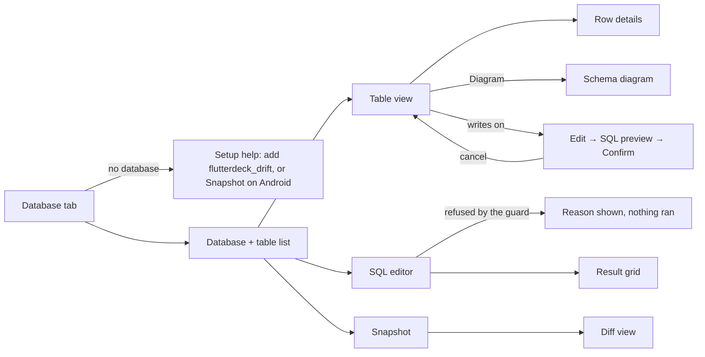

# M3 Database tab — UI spec

Date: 2026-10-16 — Design note: [design/m3-drift-inspector.md](../design/m3-drift-inspector.md) — Status: approved by PM 16 Oct 2026

Builds on [ui/m2-dashboard.md](m2-dashboard.md): same header, tokens, breakpoints, focus rules and copy style. The Database tab becomes the first tab: **Database · Logs · Activity**.

## User and task

- User: a Flutter developer whose app uses Drift, working in Claude Desktop.
- Task: see what the app saved, find rows fast, run a quick SQL query, see what an action changed, and (rarely, on purpose) fix a row.
- Success: a new row appears and flashes within 1 s; any table opens in under 1 s; a SQL query runs with Cmd/Ctrl+Enter; "what changed" takes two clicks (Snapshot, then Diff); no write happens without a visible confirm.

## Flow



## Layout (420 px)

```
┌──────────────────────────────────────────┐
│ header (as M2)                           │
├──────────────────────────────────────────┤
│  Database   Logs   Activity              │
├──────────────────────────────────────────┤
│ [▾ app.sqlite · live ●]  [Snapshot] [⋯]  │  database picker + actions
│ [▾ orders (128)]  [Table|Diagram|SQL|Diff]│  table picker + views (segmented)
├──────────────────────────────────────────┤
│ Filter rows…            ⇅ created ▾      │
│ id  item        status    created        │  virtualised grid, sticky header
│ 128 Coffee      pending   12:01:02  ← flash
│ …                                        │
├──────────────────────────────────────────┤
│ 1–100 of 128   ◀ ▶          Export ▾     │
└──────────────────────────────────────────┘
```

At ≥ 900 px the table list becomes a left sidebar (tables with row counts) and the view fills the rest.

## States matrix

| Screen / component     | Default                                                                                                                        | Hover            | Focus                                                       | Disabled                                                                | Loading              | Empty                                                                                                                                              | Error                                                                                              | Success                                                                                                        | Long content                                                                 | Offline                       | Permission denied                                                                         |
| ---------------------- | ------------------------------------------------------------------------------------------------------------------------------ | ---------------- | ----------------------------------------------------------- | ----------------------------------------------------------------------- | -------------------- | -------------------------------------------------------------------------------------------------------------------------------------------------- | -------------------------------------------------------------------------------------------------- | -------------------------------------------------------------------------------------------------------------- | ---------------------------------------------------------------------------- | ----------------------------- | ----------------------------------------------------------------------------------------- |
| Database picker        | Name, backend badge "Live" or "Snapshot 14:02"                                                                                 | Tint             | Focus ring; Enter opens                                     | No app attached                                                         | "Finding databases…" | Setup card: "Add flutterdeck_drift to see your database live" + one-line snippet + "Copy"; on Android and the iOS simulator also "Take a snapshot" | "Couldn't read databases: <reason>. Retry"                                                         | Selected db                                                                                                    | Name truncated, full in `title`                                              | Disabled, last db greyed      | Snapshot: "This app isn't debuggable, so Android won't let FlutterDeck copy its database" |
| Table picker / sidebar | Tables with row counts                                                                                                         | Tint             | Focus ring; arrows move                                     | n/a                                                                     | Skeleton rows        | "No tables in this database"                                                                                                                       | "Couldn't read the schema" + Retry                                                                 | Selected table                                                                                                 | Names truncated                                                              | Disabled                      | n/a                                                                                       |
| Table view (grid)      | Virtualised rows, sticky header, 100 per page                                                                                  | Row tint         | Cell focus ring; arrows move; Enter opens row details       | n/a                                                                     | Skeleton rows        | "No rows yet" (+ "Clear filter" if filtered)                                                                                                       | "Couldn't read rows: <reason>" + Retry                                                             | New/changed rows flash for 1.5 s (reduced motion: a 2 s outline instead); "3 new rows" chip when scrolled away | Cells one line with ellipsis; full value in row details; blobs "BLOB 2.1 KB" | Banner as M2; keeps rows      | n/a                                                                                       |
| Column header          | Name, type, PK/FK marks                                                                                                        | Tint + sort hint | Focus ring; Enter cycles sort                               | n/a                                                                     | n/a                  | n/a                                                                                                                                                | n/a                                                                                                | Sorted ▲/▼                                                                                                     | Truncated, full in `title`                                                   | n/a                           | n/a                                                                                       |
| Foreign-key cell       | Underlined value                                                                                                               | Tint             | Focus ring                                                  | n/a                                                                     | n/a                  | NULL shown as "null" in muted text                                                                                                                 | "Row not found" toast                                                                              | Opens the referenced table filtered to that row                                                                | n/a                                                                          | n/a                           | n/a                                                                                       |
| Row details panel      | All columns, full values, copy per value                                                                                       | n/a              | Focus moves into panel; Escape closes and returns focus     | n/a                                                                     | n/a                  | n/a                                                                                                                                                | n/a                                                                                                | n/a                                                                                                            | Long text scrolls inside the panel                                           | n/a                           | n/a                                                                                       |
| Schema diagram         | Tables as boxes with columns, FK lines                                                                                         | Box tint         | Each table box focusable; Enter opens it                    | n/a                                                                     | "Drawing…"           | "No tables"                                                                                                                                        | "Couldn't read the schema"                                                                         | n/a                                                                                                            | Large schemas: zoom buttons (+/−/fit) and pan by drag or arrow keys          | Last diagram kept             | n/a                                                                                       |
| SQL editor             | CodeMirror, SQLite dialect, schema autocomplete                                                                                | n/a              | Editor focus; Cmd/Ctrl+Enter runs; Escape leaves the editor | Running                                                                 | "Running…" + Cancel  | Placeholder "SELECT * FROM orders LIMIT 20"                                                                                                        | Guard refusal: "Only reading queries run here: <reason>"; SQL error: SQLite's message, line marked | Result grid + "128 rows in 12 ms"                                                                              | Results cap at 1,000 rows: "Showing the first 1,000 rows"                    | Disabled with "Not connected" | n/a                                                                                       |
| Saved queries          | List in ⋯ menu: name, Run, Rename, Delete                                                                                      | Tint             | Focus ring                                                  | n/a                                                                     | n/a                  | "No saved queries. Save the current query with Cmd/Ctrl+S"                                                                                         | "Couldn't save queries"                                                                            | Saved toast                                                                                                    | Names truncated                                                              | Usable                        | n/a                                                                                       |
| Snapshot button        | "Snapshot"                                                                                                                     | Tint             | Focus ring                                                  | No database                                                             | "Taking snapshot…"   | n/a                                                                                                                                                | "Couldn't take a snapshot: <reason>"                                                               | "Snapshot 14:02 taken" chip; Diff view enabled                                                                 | n/a                                                                          | Disabled                      | n/a                                                                                       |
| Diff view              | Per table: added (green +), changed (amber ~, changed columns bold), removed (red −), counts first                             | Row tint         | Focus ring per row                                          | No snapshot: "Take a snapshot first, then use the app"                  | "Comparing…"         | "No changes since 14:02"                                                                                                                           | "Couldn't compare: <reason>"                                                                       | Counts + rows                                                                                                  | Per table cap 200 rows: "and 340 more"                                       | Disabled                      | n/a                                                                                       |
| Export menu            | CSV · JSON (table or result)                                                                                                   | Tint             | Focus ring                                                  | No rows                                                                 | "Preparing…"         | n/a                                                                                                                                                | "Export failed"                                                                                    | File saved by the browser                                                                                      | Large tables export the current filter/query, cap 100,000 rows with a note   | Disabled                      | n/a                                                                                       |
| Editing (writes on)    | "Writes on" pill in the picker row; Edit / Delete row / Add row in row details                                                 | Tint             | Focus ring                                                  | Writes off: buttons hidden; snapshot backend: "Snapshots are read-only" | "Saving…"            | n/a                                                                                                                                                | "Couldn't save: <SQLite message>"                                                                  | Row flashes                                                                                                    | n/a                                                                          | Disabled                      | n/a                                                                                       |
| Write confirm dialog   | Title "Run this change?", the exact SQL, affected table, "Run change" / "Cancel"; Claude's requests show "Claude asks to run:" | n/a              | Focus on Cancel first; Escape cancels                       | n/a                                                                     | "Running…"           | n/a                                                                                                                                                | Error text in the dialog                                                                           | Closes; toast "1 row changed"                                                                                  | SQL scrolls inside the dialog                                                | n/a                           | Timeout: "Not run: no answer in 60 s"                                                     |

## Breakpoints

- 320 px: pickers stack full width; view switcher becomes a select; grid shows first 2 columns + "more" (row details for the rest); diagram is list-style (table → columns → links) instead of boxes.
- 420 px: layout above.
- ≥ 900 px: sidebar of tables (240 px), view fills the rest; diagram as boxes.

## Accessibility notes

- Grid uses the ARIA grid pattern (`role=grid`, row/column headers, arrow-key cell navigation, `aria-sort`); not every one of 10,000 rows in the DOM (virtualised) with `aria-rowcount`.
- Flash is also announced politely once per batch: "3 rows added to orders" (not per row).
- Diff uses words and symbols (+ added, ~ changed, − removed), not colour alone.
- The SQL editor has a visible label "SQL", and the run shortcut is in the Run button's `aria-keyshortcuts`. Tab inside CodeMirror indents only after Escape-then-Tab is documented; the default is that Tab moves focus out (no keyboard trap, SC 2.1.2).
- Confirm dialog: `role=alertdialog`, focus trapped while open, returns to the trigger.
- Diagram boxes are focusable buttons with names "orders table, 4 columns, links to customers"; the 320 px list version is the accessible alternative for screen readers at all sizes (a "List view" toggle).
- Targets ≥ 24×24 px; contrast checked from tokens in both themes (green/amber/red diff colours meet 4.5:1 for text).

## Copy

- Setup: "Add flutterdeck_drift to see your database live." · "In your app's main(), after you create the database: `FlutterDeckDrift.register(db, name: 'app');` It does nothing in release builds."
- Snapshot banner: "Snapshot from 14:02 — this is a copy, not live. Refresh"
- Guard refusal: "Only reading queries run here. This one would change data (<reason>)." Reasons: "it deletes rows", "it adds a database", "it changes a setting", "it has more than one statement".
- Writes off (when asked): "Changing data is off. Turn it on with db.allowWrites in .flutterdeck/config.json."
- Writes on pill: "Writes on" (from config) — tooltip "Every change still asks you first".
- Confirm: "Run this change?" · "Claude asks to run:" · "Run change" · "Cancel".
- Diff empty: "No changes since 14:02."
- Hidden column cell (dashboard shows real data; this copy is for Claude-facing output only): "[hidden]".

## Tokens used

As M2, plus `color.diff.added`, `color.diff.changed`, `color.diff.removed` (text and 12% tint backgrounds, both themes), `color.flash` (row flash tint), `font.mono` for SQL and cell values.
